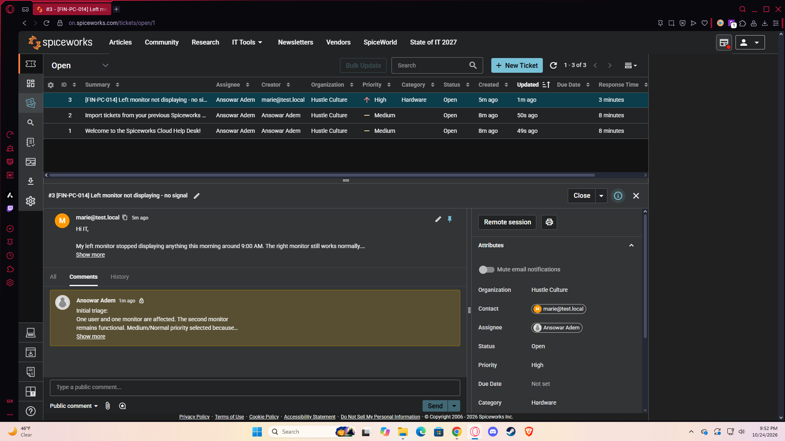
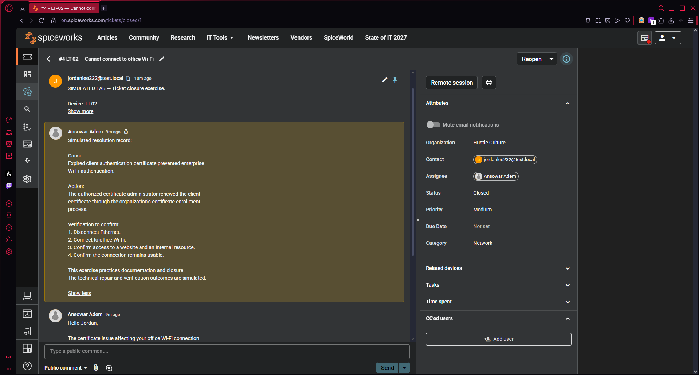
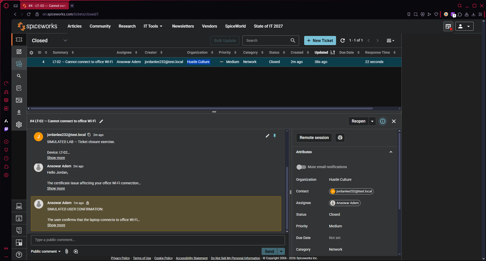
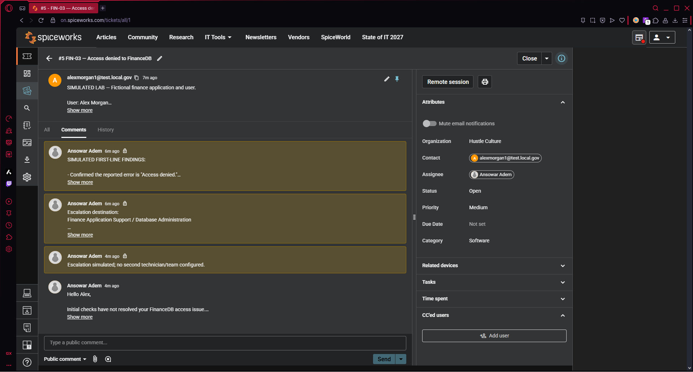
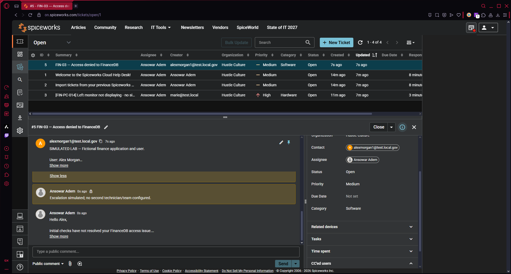

# IT Help Desk Ticketing Lab

## Overview

I used Spiceworks Cloud Help Desk to practice handling support
tickets from initial intake through closure or escalation.

The project includes three scenarios:
- A monitor displaying no signal.
- A laptop unable to connect to office Wi-Fi.
- A user unable to access a financial database.

I practiced categorizing requests, assigning priorities,
documenting findings, writing user updates, and recording
resolution or escalation details.

**Lab scope:** All users, devices, and technical incidents are
fictional. I performed the ticketing actions in Spiceworks.
The technical troubleshooting findings, certificate renewal,
and user confirmations were simulated. No production systems
were changed.

## Tools

- Spiceworks Cloud Help Desk
- Web browser
- GitHub for project documentation
- Screenshots of ticket records and notes

## Ticket Summary

| Ticket | Scenario | Category | Priority | Final recorded status |
|---|---|---|---|---|
| #3 | Left monitor displaying no signal | Hardware | High | Open |
| #4 | Laptop unable to connect to office Wi-Fi | Network | Medium | Closed |
| #5 | Access denied to FinanceDB | Software | Medium | Open — escalation documented |

Ticket #3 retains the High priority selected for the exercise.
In a workplace, priority should be validated against the
organization's impact and urgency criteria.

## Lab 1: Ticket Creation and Initial Triage

### Scenario

A user reported that the left monitor on FIN-PC-014 stopped
displaying an image. The right monitor remained functional.

### Actions

1. Created ticket #3 with a descriptive subject.
2. Recorded the reported issue and available background.
3. Categorized the ticket as Hardware.
4. Assigned the ticket to myself.
5. Set the priority to High for the exercise.
6. Added an internal triage note describing the scope and
   planned troubleshooting.

### Planned Troubleshooting

- Verify that the monitor has power.
- Check the selected input source.
- Reseat the display cable.
- Test with a known-good cable or display.
- Check whether Windows detects the monitor.

These were planned checks, not completed hardware repairs.

### Outcome

The ticket remained open for investigation. This exercise
focused on creating a clear support record and documenting
initial triage.

### Evidence

*Ticket #3 records the hardware issue and initial triage.*

## Lab 2: Resolution Documentation and Ticket Closure

### Scenario

A fictional user reported that laptop LT-02 could no longer
connect to office Wi-Fi.

The supplied scenario identified an expired client
authentication certificate as the cause. Certificate renewal
by an authorized administrator was assumed for this exercise.

### Actions

1. Created ticket #4 and categorized it as Network.
2. Assigned Medium priority.
3. Added an internal simulated resolution record.
4. Documented the supplied cause and corrective action.
5. Listed the checks needed to verify connectivity.
6. Added a user-facing update requesting confirmation.
7. Recorded simulated user confirmation.
8. Closed the ticket.

### Verification Checklist

- Disconnect Ethernet.
- Connect to office Wi-Fi.
- Confirm access to a website.
- Confirm access to an internal resource.
- Confirm that the connection remains usable.

The verification results were simulated; no enterprise
Wi-Fi certificate infrastructure was configured in this lab.

### Outcome

Ticket #4 was closed after documenting the simulated
resolution and user confirmation.

### Evidence

*The internal note documents the simulated cause, corrective
action, and verification checklist.*

*Simulated user confirmation was recorded before closure.*

## Lab 3: Escalation Documentation

### Scenario

A fictional finance user received an "Access denied" error
when attempting to access FinanceDB.

The supplied first-line findings indicated that Windows
sign-in and basic connectivity were working. Help desk did
not have authority to modify the application's permissions.

### Actions

1. Created ticket #5 for the application access issue.
2. Categorized it as Software and assigned Medium priority.
3. Recorded simulated first-line troubleshooting findings.
4. Identified Finance Application Support / Database
   Administration as the intended escalation destination.
5. Documented the reason for escalation and requested
   investigation.
6. Recorded that escalation was simulated because no second
   technician or team was configured.
7. Added a user-facing update.
8. Left the ticket open because the issue remained unresolved.

### Escalation Handoff

The handoff documented:
- The affected user and device.
- The application and reported error.
- The business impact.
- The first-line checks and their supplied results.
- The help desk's permission limitations.
- The requested read-only access.
- The need to verify approval before changing permissions.

### Environment Limitation

No dedicated escalation button was available in my workflow.
I recorded the handoff in internal notes.

No actual reassignment or notification to another team took
place. In a workplace, documentation would accompany routing
or notifying the responsible support team.

### Outcome

Ticket #5 remained open with escalation documentation.
Escalation was treated as a handoff, rather than a resolution.

### Evidence

*The ticket records the intended destination and clearly
identifies the escalation as simulated.*

*The detailed handoff gives the receiving team context for
further investigation.*

## What I Learned

- Clear ticket descriptions reduce repeated questions.
- Categories help organize requests and identify ownership.
- Priority should reflect impact and urgency.
- Internal notes and user-facing updates serve different purposes.
- Resolution notes should explain the cause, action, and verification.
- User confirmation supports proper ticket closure.
- Escalation requires a clear handoff and appropriate ownership.
- An unresolved ticket should remain open after escalation.

## Skills Practiced

- Ticket creation and categorization
- Initial triage documentation
- Priority selection
- Internal work notes
- User communication
- Resolution documentation
- Ticket closure
- Escalation handoffs
- Technical portfolio documentation
